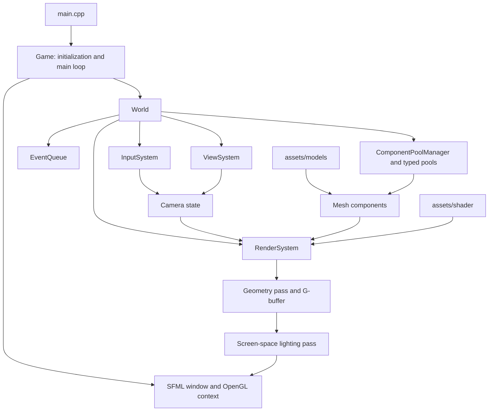

# CosmoLib

CosmoLib is a C++14 graphics and world simulation project built with CMake. It combines an entity-component-system (ECS) architecture, pooled component storage, an OpenGL deferred renderer, model loading, procedural noise, chunk-based terrain code, and several voxel surface-generation implementations.

The CMake application target is **`CosmoLib`**. Its window is titled **Cosmo**. The startup scene loads the bundled `tree.obj` model, initializes a camera, and draws the scene through geometry and lighting passes.

## Contents

- [Project structure](#project-structure)
- [Dependencies and prerequisites](#dependencies-and-prerequisites)
- [Configure, build, and run](#configure-build-and-run)
- [Configuration and assets](#configuration-and-assets)
- [Application lifecycle](#application-lifecycle)
- [Entities, components, and memory](#entities-components-and-memory)
- [Systems](#systems)
- [Rendering](#rendering)
- [Terrain and procedural generation](#terrain-and-procedural-generation)
- [Events](#events)
- [Controls](#controls)
- [Working on the project](#working-on-the-project)
- [Source reading guide](#source-reading-guide)

## Project structure

```text
Lib/
|-- CMakeLists.txt                 Application target, sources, dependencies, compiler settings
|-- config.h.in                    Template for generated paths and runtime constants
|-- assets/
|   |-- models/                   OBJ, MTL, and PLY model assets
|   `-- shader/                   GLSL geometry, lighting, simple, and test shaders
|-- source/
|   |-- main.cpp                  Application entry point
|   |-- Game.h / Game.cpp         Window creation, initialization, and main loop
|   |-- World.h / World.cpp       Shared world state and system coordination
|   |-- Forward.h                 Common IDs, aliases, and component bitsets
|   |-- Constants.h               Entity/system capacities and chunk size
|   |-- config.h                  Header generated by CMake
|   |-- Components/               Transform, camera, mesh, and simulation data types
|   |-- Memory/                   Typed pools and component pool management
|   |-- Systems/                  Input, view, rendering, and simulation system sources
|   |-- EntitySpawner/            Player and terrain entity construction
|   |-- EventManager/             Event queue, subscriptions, and event types
|   |-- Rendering/                Shader programs, uniforms, G-buffer, and lighting types
|   |-- Terrain/                  Chunk records, coordinate helpers, and mesh-related files
|   |-- Math/
|   |   |-- Noise/                Perlin and Simplex noise
|   |   `-- SurfaceGeneration/
|   |       |-- DualContouring/   Hermite-field contouring and mathematical helpers
|   |       |-- DualMarchingCubes/ Dual marching cubes implementation
|   |       `-- Voxels/           Voxel grid, polygonizer, materials, and library support
|   |-- VoxelProc.h / .cpp        Procedural density surface
|   |-- TestMaterialMap.h / .cpp  Voxel material map implementations
|   |-- Container/                Container source files
|   `-- utils.h / utils.cpp       File reading and interpolation helpers
|-- glm-0.9.9.3/                   Bundled GLM headers, CMake integration, docs, and tests
|-- external/                     Third-party source directories and CMake entry point
|-- cmake_modules/                Package discovery and CMake support modules
|-- libs/
|   |-- CMakeLists.txt
|   `-- Rendering/               Additional rendering source files
|-- cmake-build-debug/            Local Debug build output
`-- cmake-build-release/          Local Release build output
```

The main executable's source list is maintained explicitly in the root [CMakeLists.txt](CMakeLists.txt). The application rendering implementation lives in [source/Rendering](source/Rendering), alongside [RenderSystem](source/Systems/RenderSystem.cpp).

The [external](external) directory contains source trees for Assimp, Bullet, GLEW, Dual Contouring, and dual marching cubes. The root build includes the bundled GLM directory and `external/CMakeLists.txt`; that external entry point includes `DualContouring`. Graphics and asset-import dependencies are also resolved through CMake package discovery.

## Dependencies and prerequisites

Prepare a C++ development environment with the following components:

| Component | Role in the project | Build integration |
| --- | --- | --- |
| C++14 compiler | Compiles the application and its source libraries | `CMAKE_CXX_STANDARD` is set to `14` |
| CMake and a build tool | Configures and builds the project | Root project name: `CosmoLib`; generators can use Make, Ninja, or Visual Studio |
| OpenGL development libraries and graphics driver | Provides the graphics API and runtime context | `find_package(OpenGL REQUIRED)` |
| GLEW | Loads OpenGL entry points | `GLEW::GLEW` and `GLEW_INCLUDE_DIRS` |
| SFML 2.5-compatible development package | Supplies the window, input events, clock, and linked SFML modules | Components: `graphics`, `window`, `audio`, `system` |
| Assimp | Imports model scenes and meshes | `ASSIMP_INCLUDE_DIRS` and `ASSIMP_LIBRARIES` |
| Bullet | Supplies physics-related headers and libraries | Bullet discovery and `BULLET_LIBRARIES` |
| OpenMP compiler/runtime support | Supports parallel terrain work and OpenMP includes | `OpenMP::OpenMP_CXX` |
| GLM 0.9.9.3 | Provides vectors, matrices, quaternions, transforms, and noise functions | Bundled under `glm-0.9.9.3/` |

The configured graphics context is **OpenGL 4.5 Core**, and the geometry and lighting shaders use **GLSL 450**. Use a graphics environment supporting that context.

The root CMake file declares a minimum CMake version of `3.1`; the bundled GLM CMake file declares `3.2`. The commands below use the `-S`/`-B` syntax available in CMake 3.13 and later. The toolchain should also provide the imported OpenMP C++ target used by the application.

For native development, install the headers and libraries for the same architecture and compiler toolchain as the application. Windows setups can use a Visual Studio C++ toolchain; Unix-like setups can use a C++14-capable GCC or Clang toolchain with the corresponding OpenMP runtime.

### Dependency discovery

CMake searches installed package locations and accepts additional prefixes and package directories through its cache.

| CMake setting | Purpose |
| --- | --- |
| `CMAKE_PREFIX_PATH` | A semicolon-separated list of dependency installation prefixes |
| `SFML_DIR` | Directory containing the SFML CMake package configuration |
| `ASSIMP_DIR` | Directory containing the Assimp CMake package configuration used by the `ASSIMP` lookup |
| `BULLET_ROOT` | Bullet installation or build root searched by the bundled discovery module |
| `BULLET_INCLUDE_DIR` | Bullet header directory used by the root build |
| `GLEW_INCLUDE_DIR` | Directory containing `GL/glew.h` |
| `GLEW_SHARED_LIBRARY_RELEASE` / `GLEW_SHARED_LIBRARY_DEBUG` | Explicit GLEW shared-library locations for each configuration |
| `GLEW_USE_STATIC_LIBS` | Selects static GLEW discovery |
| `ASSETS_DIR` | Asset root compiled into the generated configuration header |

The root configuration adds `C:/libs/glew` to its prefix search path and `C:/libs/glew/lib/Release/x64` to its library search path. Additional installation locations can be supplied through the cache settings above.

The bundled Bullet module searches the Dynamics, Collision, LinearMath, and SoftBody libraries. Provide a Bullet development installation containing these libraries.

## Configure, build, and run

Run these commands from the directory containing the root `CMakeLists.txt`.

### Debug build

With dependencies available to CMake:

```sh
cmake -S . -B cmake-build-debug -DCMAKE_BUILD_TYPE=Debug
cmake --build cmake-build-debug --target CosmoLib
```

For a single-configuration generator, the executable is typically placed directly in the build directory:

```sh
./cmake-build-debug/CosmoLib
```

A single-configuration Windows generator produces `CosmoLib.exe` in the corresponding build directory.

### Release build

```sh
cmake -S . -B cmake-build-release -DCMAKE_BUILD_TYPE=Release
cmake --build cmake-build-release --target CosmoLib
./cmake-build-release/CosmoLib
```

Separate build directories keep each configuration's cache and artifacts together.

### Windows with Visual Studio

From a developer shell, select an installed Visual Studio generator and configure a matching architecture. For example, with Visual Studio 2022:

```powershell
cmake -S . -B buildmsvc -G "Visual Studio 17 2022" -A x64
cmake --build buildmsvc --config Debug --target CosmoLib
.\buildmsvc\Debug\CosmoLib.exe
```

For the same generated project in Release mode:

```powershell
cmake --build buildmsvc --config Release --target CosmoLib
.\buildmsvc\Release\CosmoLib.exe
```

The project sets the multi-configuration choices to `Debug;Release`. Visual Studio source groups mirror the `source/` directory tree.

### Custom dependency locations

Supply installation prefixes when configuring. This PowerShell example uses illustrative locations under `C:/libs`; adapt them to your installation:

```powershell
cmake -S . -B buildmsvc -G "Visual Studio 17 2022" -A x64 "-DCMAKE_PREFIX_PATH=C:/libs/SFML;C:/libs/assimp;C:/libs/glew" -DBULLET_ROOT=C:/libs/bullet
```

A package configuration directory can also be selected explicitly:

```sh
cmake -S . -B cmake-build-debug -DCMAKE_BUILD_TYPE=Debug -DASSIMP_DIR=/path/to/assimp/lib/cmake/assimp
```

CMake records these selections in the build directory's `CMakeCache.txt`. You can inspect the visible cache entries with:

```sh
cmake -L -N cmake-build-debug
```

For shared-library builds, make the selected dependencies' runtime libraries available to the operating system loader. On Windows, this can be done through `PATH` or by placing the required DLLs beside the executable.

### IDE setup

Open the root `CMakeLists.txt` as a CMake project. Select the compiler toolchain, generator, build directory, and Debug or Release configuration, then pass dependency paths as CMake options. Choose `CosmoLib` as the application target.

Asset lookup uses paths generated during CMake configuration. Configure the project on the machine and checkout from which it will run, and keep the selected asset directory accessible at runtime.

## Configuration and assets

### Generated configuration

[config.h.in](config.h.in) is processed by `configure_file` into [source/config.h](source/config.h). It combines the selected asset root with graphics and update-loop settings.

| Setting | Configured value | Use |
| --- | --- | --- |
| `ASSETS_DIR` | Repository `assets/` directory by default | General asset root |
| `SHADER_DIR` | `ASSETS_DIR/shader/` | Shader source lookup |
| `MODEL_DIR` | `ASSETS_DIR/models/` | Model lookup |
| `OPENGL_MAJOR_VERSION` / `OPENGL_MINOR_VERSION` | `4` / `5` | Requested OpenGL context |
| `DEPTH_BITS` | `24` | Requested depth-buffer precision |
| `STENCIL_BITS` | `8` | Requested stencil-buffer precision |
| `ANTIALIASING_LEVEL` | `16` | Requested SFML context antialiasing level |
| `FRAME_LIMIT` | `60` | Frame-limit constant available in the configuration |
| `PHYSICS_FRAMERATE` | `120` | Fixed world-update frequency |

Set asset paths through the CMake cache. For example:

```sh
cmake -S . -B cmake-build-debug -DASSETS_DIR=/absolute/path/to/assets
```

The selected directory should contain `models/` and `shader/`. CMake formats the asset path for Windows when configuring on that platform.

Edit graphics and timing constants in `config.h.in`, then rerun CMake and rebuild to refresh the generated header. The window dimensions are set in `Game.cpp`, while camera projection dimensions are set in `ViewSystem.cpp`; both use **1440 × 900**.

### Models

[assets/models](assets/models) contains:

- `tree.obj` and `tree.mtl`: the model and material description used by the startup scene.
- `cube.obj` and `cube.mtl`: cube model assets.
- `deer.obj`: an additional OBJ model.
- `bun000.ply`, `bun045.ply`, `bun090.ply`, `bun180.ply`, `bun270.ply`, `bun315.ply`, `chin.ply`, `ear_back.ply`, `top2.ply`, and `top3.ply`: PLY model data.

`Components::Mesh::loadMesh` resolves the supplied filename relative to `MODEL_DIR`. The startup model is selected by the `loadMesh("tree.obj")` call in `RenderSystem::init`.

### Shaders

| Shader files | Role |
| --- | --- |
| `geometryPass.vs`, `geometryPass.fs` | Transform mesh data and write position, color, and normal outputs |
| `lightingPass.vs`, `lightingPass.fs` | Draw the screen-space lighting pass using G-buffer textures |
| `simple.vert`, `simple.frag` | Additional simple shader sources |
| `test.vs`, `test.fs` | Additional test shader sources |

The `Program` helper maps shader stages to filename extensions: vertex to `.vs`, fragment to `.fs`, geometry to `.gs`, tessellation control to `.tcs`, and tessellation evaluation to `.tes`.

## Application lifecycle

The main ownership and processing relationships are:



1. **Entry point:** `main()` constructs `Cosmo::Game`, calls `init()`, and enters `run()`.
2. **Window and context:** `Game::init()` creates the SFML window and activates its OpenGL context.
3. **Component storage:** pools are initialized for position, velocity, color, ground state, collider, rotation, forward direction, scale, and mesh data.
4. **Update systems:** `InputSystem` and `ViewSystem` are registered with initialization and update priorities `0` and `1`.
5. **Graphics initialization:** GLEW is initialized, back-face culling is enabled, and the world initializes its systems and renderer.
6. **Scene initialization:** `RenderSystem` creates the model entity, shader programs, G-buffer, screen-space quad, and lighting uniforms.
7. **Fixed updates:** the game accumulates elapsed time and calls `World::update` in steps of `1 / PHYSICS_FRAMERATE`.
8. **Rendering:** each outer loop iteration calls `World::render`, which updates the render system and presents the window.
9. **Shutdown:** window-close events and Escape call `World::kill()`, ending the loop.

At the start of each world update, queued events are broadcast and shared system timing is updated. Registered systems then run in their assigned update order. Rendering has its own call through `World::render()`.

## Entities, components, and memory

### Entity model

Entities are integer `EntityID` values. Components hold typed data associated with those IDs, and systems request sets of entities matching a component signature.

[Forward.h](source/Forward.h) defines the shared aliases:

- `EntityID`, `ComponentID`, and `SystemID` use the common integer ID type.
- `EntitySet` is a `std::set<EntityID>`.
- `ComponentBitset` is a bitset sized by `maxComponents`.

Component type IDs are assigned through `getComponentTypeID<T>()`. Systems use an equivalent `getSystemTypeID<T>()` mechanism.

### Component groups

The main component definitions live in [source/Components](source/Components).

| Group | Types | Data represented |
| --- | --- | --- |
| Transform | `Position`, `Rotation`, `Scale` | Spatial position, quaternion rotation, and scale |
| Motion | `Velocity`, `Forward` | Velocity and forward-direction data |
| Appearance | `Color`, `Mesh` | Color values and imported GPU mesh data |
| Contact state | `OnGround`, `Collider` | Ground-state flag and bounding-volume data |
| Camera | `Camera`, `View` | Camera position/orientation, view matrix, projection parameters, and projection matrix |
| Flags | `Active`, `Renderable` | Additional component flag definitions |

The `Collider` type contains both axis-aligned bounding-box data (`AABB`) and oriented bounding-box data (`OBB`). The OBB stores its position, half-size, and three orientation axes.

`World` owns its `Camera` and `View` objects directly. The renderer and input/view systems access them through `getCamera()` and `getView()`.

### Component pools

[ComponentPoolManager](source/Memory/PoolManager.h) coordinates entity creation, component storage, signatures, and matching entity sets.

The storage layers are:

- **`BasePool`:** common interface for restoring data according to an entity-ID mapping.
- **`Pool<T, maxObjects>`:** typed array storage, indexed access, object creation/removal, free-slot tracking, and restoration.
- **`ComponentPoolManager`:** typed pool registration, per-entity component bitsets, component access, and query-set registration.

[Constants.h](source/Constants.h) defines these capacities:

| Constant | Value |
| --- | --- |
| `maxComponents` | `32` |
| `maxSystems` | `32` |
| `maxEntities` | `1024 * 1024` |
| `chunkSize` | `16` |
| `undefinedID` | `-1` |

Each typed pool allocates its component array up front. These constants therefore influence both the supported entity count and the storage allocated during initialization.

### Entity construction and queries

The entity creation sequence is:

1. Initialize the required component pools.
2. Register component signatures used by systems.
3. Allocate an ID with `createNewEntity()`.
4. Attach and populate components with `addComponent<T>(id)`.
5. Call `finalizeEntity(id)` to add the entity to matching registered sets.

For example, with `world` referring to an initialized `Cosmo::World` and the relevant pools already registered:

```cpp
auto* manager = world.getManager();
const auto id = manager->createNewEntity();

manager->addComponent<Cosmo::Components::Position>(id)
       .set(0.0f, 2.0f, 0.0f);
manager->addComponent<Cosmo::Components::Color>(id)
       .set(0.2f, 0.8f, 0.4f);

manager->finalizeEntity(id);
```

A system registers a signature with `initComponentBitset<Ts...>()` and obtains its matching `EntitySet` through `getEntitySet(bitset)`. The renderer uses a signature containing `Components::Mesh`.

### Spawners

[PlayerSpawner](source/EntitySpawner/PlayerSpawner.cpp) groups the creation of a player entity with position, velocity, forward direction, rotation, ground state, color, collider, and scale components.

[TerrainSpawner](source/EntitySpawner/TerrainSpawner.cpp) creates terrain block entities for a selected chunk and resolution. It attaches position, collider, scale, and height-dependent color data, then finalizes each entity.

## Systems

[System](source/Systems/System.h) defines the common `init(World*)`, `update()`, and `onUpdate()` lifecycle. It also provides shared elapsed/delta time and helpers for recording system timing.

`World::addSystem<T>(initPriority, updatePriority, ...)` constructs a system and records its type, ownership, and ordering. Both priority arrays are traversed from zero through the registered system count, so registration uses consecutive, unique priority slots.

### Startup systems

| System | Responsibility in the startup path |
| --- | --- |
| [InputSystem](source/Systems/InputSystem.cpp) | Polls SFML events, handles shutdown, updates camera state, and recenters the mouse |
| [ViewSystem](source/Systems/ViewSystem.cpp) | Initializes the camera/projection and refreshes view and projection matrices |
| [RenderSystem](source/Systems/RenderSystem.cpp) | Initializes scene meshes and graphics resources, draws geometry, applies lighting, and presents the frame |

`InputSystem` and `ViewSystem` participate in the ordered world-update list. `World` creates and invokes `RenderSystem` through its rendering lifecycle.

### Simulation-related source groups

The `Systems/` directory also includes:

| Files | Area represented |
| --- | --- |
| `PhysicsSystem.h/.cpp` | Physics system type and lifecycle hooks |
| `MoveForwardSystem.h/.cpp` | Directional movement system type and timing hooks |
| `UpdateBoundingBoxesSystem.h/.cpp` | Bounding-box update system with a position/velocity/collider signature |
| `CollisionSystem.h/.cpp` | Collision system and AABB, OBB, and separating-plane interfaces |
| `CollisionHandlerSystem.h/.cpp` | Collision handler system and event-handler integration |
| `TerrainSpawnerSystem.h/.cpp` | Player-chunk tracking and queues for terrain loading and deletion |

These files sit alongside the shared system base and provide the project's simulation-related organization.

## Rendering

### Mesh import and GPU data

[MeshComponent](source/Components/MeshComponent.cpp) uses Assimp to read model files. The import flags request triangulation, smooth normals, UV flipping, and identical-vertex joining.

Each mesh vertex contains:

- Position (`glm::vec3`).
- Texture coordinates (`glm::vec2`).
- Normal (`glm::vec3`).
- Color (`glm::vec3`).

A `MeshEntry` stores the OpenGL vertex array, vertex buffer, index buffer, index count, and material index for an imported submesh. Rendering binds each entry and issues indexed triangle draws.

### Geometry pass

The geometry pass draws mesh components into [GBuffer](source/Rendering/GBuffer.h). Its attachments store:

| Attachment | Texture unit | Contents |
| --- | --- | --- |
| Position | `0` | Position data emitted by the geometry shader pair |
| Diffuse | `1` | Vertex color |
| Normal | `2` | Surface normal |

The G-buffer also owns a depth texture. During geometry rendering, depth testing and depth writes are enabled, and blending is disabled.

### Lighting pass

The lighting pass reads the G-buffer and draws a full-screen quad. The fragment shader combines stored color with ambient and directional diffuse lighting, then applies distance-based fog.

The supporting light types are defined in [Rendering/Lighting](source/Rendering/Lighting):

- `BaseLight`: color, ambient intensity, and diffuse intensity.
- `DirectionalLight`: a base light and direction.
- `PointLight`: a base light, position, and attenuation terms.

The startup renderer sets up a directional light and a blue fog color. Lighting parameters, camera position, and screen size are passed to the shader through uniforms.

### Programs and uniforms

[Program](source/Rendering/Program.h) collects shader stages, resolves source paths under `SHADER_DIR`, creates a linked program, and selects it for drawing.

[Uniform](source/Rendering/Uniform.h) binds C++ values to shader uniform locations. Specializations support `float`, `glm::vec3`, `glm::mat3`, `glm::mat4`, directional lights, and point lights. `Program::updateUniforms()` uploads values from their registered data pointers.

[Rendering/utils](source/Rendering/utils.h) supplies shader compilation, program linking, and related graphics helpers.

## Terrain and procedural generation

### Chunks and world storage

[Terrain::Chunk](source/Terrain/Chunk.h) stores a chunk's position, coordinate-derived ID, and list of block entity IDs. It also supports updating those IDs using a mapping produced during entity storage changes.

`World` maintains chunks in a map keyed by an `(x, z)` coordinate pair. Its chunk API covers insertion, lookup, radius queries, iteration, loaded-state checks, and deletion.

The chunk dimension is controlled by `Cosmo::chunkSize`, currently `16`. Chunk entity storage reserves space for `chunkSize * chunkSize` block IDs.

### Terrain generation and streaming

`TerrainSpawner` samples four-dimensional octave Simplex noise using trigonometric coordinate mapping. The sampled value determines block height, and positive/negative heights produce different interpolated green color ranges.

The spawner's resolution parameter controls its stepping through a chunk and the scale assigned to generated block entities. OpenMP is used for the outer generation loop, with a critical section around shared entity creation and chunk-ID insertion.

[TerrainSpawnerSystem](source/Systems/TerrainSpawnerSystem.cpp) organizes work around the player's chunk position:

1. Queue surrounding chunk coordinates in expanding square rings.
2. Track movement across chunk boundaries.
3. Queue newly relevant chunks for generation.
4. Queue distant chunks for deletion.
5. Process pending generation and deletion work during updates.

The system's configured chunk radius is `5`.

### Noise implementations

[source/Math/Noise](source/Math/Noise) contains Perlin and Simplex noise implementations. Terrain code uses octave Simplex noise; `VoxelProc` uses GLM's Perlin noise functions.

### Surface-generation implementations

The project contains three surface-generation code groups:

| Directory | Main data and API |
| --- | --- |
| [DualContouring](source/Math/SurfaceGeneration/DualContouring) | Hermite plane field, indexed triangle mesh, `vol::dualContouring`, mathematical solver, vectors, and 3D array helpers |
| [DualMarchingCubes](source/Math/SurfaceGeneration/DualMarchingCubes) | Templated `dualmc::DualMC`, dual vertices, quad indices, implementation templates, and lookup tables |
| [Voxels](source/Math/SurfaceGeneration/Voxels) | Voxel grid storage, procedural surface interface, materials, TransVoxel polygonization, and support utilities |

The Voxels public interfaces include:

- **`Grid`:** grid creation, dimensions, packed save/load data, density/material access, and surface/material injection.
- **`VoxelSurface`:** interface for sampling a procedural surface.
- **`Polygonizer`:** converts a grid and material map into a polygon surface.
- **`PolygonSurface` / `BlockPolygons`:** level-based block geometry, indices, transition-face geometry, bounds, and statistics.
- **`MaterialMap`:** material lookup for polygonization.
- **Library support:** version checking, logging callbacks, and configurable allocation functions.

### Procedural surface and materials

[VoxelProc](source/VoxelProc.cpp) implements the `VoxelSurface` sampling interface. It combines a plane equation with Perlin noise to produce density values and can fill material ID and blend arrays. `ProceduralParams` supplies the noise dimension and scale factors.

[TestMaterialMap](source/TestMaterialMap.h) defines `MaterialTable` and `TestMaterialTable`. The material table interface includes material lookup, texture names, and texture UV-scale properties.

## Events

The event layer lives in [source/EventManager](source/EventManager).

- **`Event`** carries the event type.
- **`Events::Collision`** carries the IDs of two entities.
- **`EventQueue`** stores queued events and subscriber lists by event type.
- **`EventHandler`** subscribes through the queue and receives events into a local list.

The queue's `broadCast()` method distributes queued event pointers to the handlers subscribed to each type, then clears the outgoing list. `World::update()` invokes this broadcast before updating its systems.

## Controls

The startup input handling is defined in [InputSystem.cpp](source/Systems/InputSystem.cpp). Camera input is processed through SFML events.

| Input | State change |
| --- | --- |
| Escape or window close | Ends the world loop |
| Mouse movement | Changes horizontal and vertical camera angles |
| A / D | Increases / decreases camera world X by `0.4` |
| W / S | Increases / decreases camera world Y by `0.4` |
| Space | Advances camera position by `0.4 * direction` |
| Q / E | Calls `moveForward(0.1)` / `moveForward(-0.1)` to adjust camera speed state |
| Left / Right arrow | Calls `moveRight(0.1)` / `moveRight(-0.4)` to adjust camera speed state |
| Up arrow | Calls `moveUp(0.4)` to adjust camera speed state |
| Mouse wheel | Adjusts the camera's `zoom` value |

The mouse cursor is hidden and recentered in the window during input updates. Camera speed helpers clamp their corresponding speed component to `maxSpeed`.

`ViewSystem` initializes the camera at `(1, 10, -3)`, uses a `45°` field of view, and sets near/far planes to `0.01` and `1000`. Each update refreshes orientation and projection matrices.

## Working on the project

### Adding source files

Add application headers and implementation files to the root `header_files` and `source_files` lists in `CMakeLists.txt`. Rerun CMake so the generated build includes them.

Compiler flags are checked for support before being added. The root build checks `-Wall`, `-Wextra`, `-pedantic`, and `-O3`.

### Adding components and systems

A typical component addition follows the existing layout:

1. Define the component under `source/Components/`, using the shared component conventions.
2. Initialize its typed pool before creating entities that use it.
3. Register any system signatures that query it.
4. Attach and initialize it during entity construction, then finalize the entity.
5. Add its files to the root CMake source lists.

A system derives from `Cosmo::System`, implements `init(World*)` and `onUpdate()`, and is registered through `World::addSystem`. The existing input and view registration in `Game::init()` provides a compact ordering example.

### Working with graphics assets

Place model assets under `assets/models/` and load them using a filename relative to `MODEL_DIR`. Keep associated asset files with the model.

Place shader sources under `assets/shader/`. Programs load them by base name and stage; for example, `geometryPass` resolves to `geometryPass.vs` and `geometryPass.fs`.

### Local build artifacts

The repository's `.gitignore` covers compiled objects, dynamic/static libraries, executables, IDE state, and local build directories including `cmake-build-debug/`, `cmake-build-release/`, and `buildmsvc/`.

The bundled GLM tree includes its own [manual](glm-0.9.9.3/manual.md), [readme](glm-0.9.9.3/readme.md), and test sources. Third-party source headers and directories carry their respective attribution and licensing information.

## Source reading guide

| To understand… | Start with… |
| --- | --- |
| Build target and dependencies | [CMakeLists.txt](CMakeLists.txt) |
| Generated paths and graphics settings | [config.h.in](config.h.in) |
| Startup and fixed update loop | [Game.cpp](source/Game.cpp) |
| Ownership, system order, and chunk access | [World.h](source/World.h), [World.cpp](source/World.cpp) |
| Entity IDs and capacities | [Forward.h](source/Forward.h), [Constants.h](source/Constants.h) |
| Component storage and matching sets | [PoolManager.h](source/Memory/PoolManager.h), [Pool.h](source/Memory/Pool.h) |
| Camera input and matrices | [InputSystem.cpp](source/Systems/InputSystem.cpp), [ViewSystem.cpp](source/Systems/ViewSystem.cpp) |
| Render passes and scene setup | [RenderSystem.cpp](source/Systems/RenderSystem.cpp) |
| Mesh import and OpenGL buffers | [MeshComponent.cpp](source/Components/MeshComponent.cpp) |
| Shader programs and data uploads | [Program.h](source/Rendering/Program.h), [Uniform.h](source/Rendering/Uniform.h) |
| Chunk generation and lifecycle | [TerrainSpawner.cpp](source/EntitySpawner/TerrainSpawner.cpp), [TerrainSpawnerSystem.cpp](source/Systems/TerrainSpawnerSystem.cpp) |
| Procedural voxel density | [VoxelProc.cpp](source/VoxelProc.cpp) |
| Voxel grid and polygonization APIs | [Voxels.h](source/Math/SurfaceGeneration/Voxels/include/Voxels.h) |
| Event subscriptions and delivery | [EventQueue.h](source/EventManager/EventQueue.h), [EventHandler.h](source/EventManager/EventHandler.h) |
